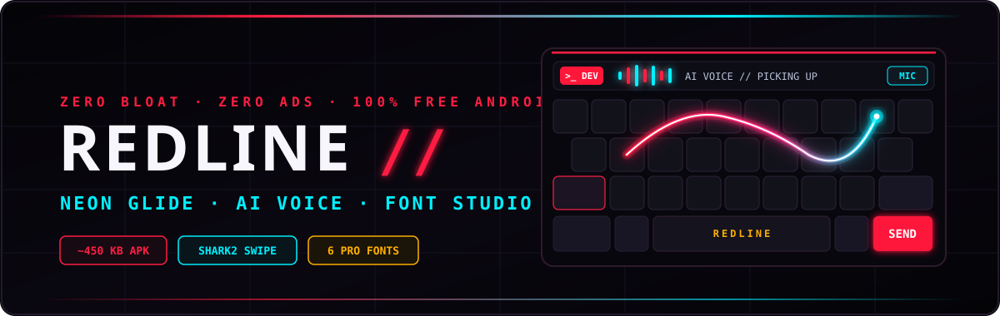

<p align="center">
  
</p>

<p align="center">
  <a href="https://github.com/apotheon369-lang/redline-keyboard/releases/latest">
    
  </a>
  
  
  
  
</p>

<h3 align="center">Ditch the 100 MB bloated default keyboard. Type at 120Hz on pure obsidian neon.</h3>

---

## ⚡ One-Tap Install (100% Free · Zero Ads · Open Source)

1. **[Download the latest `RedlineKeyboard.apk` here →](https://github.com/apotheon369-lang/redline-keyboard/releases/latest/download/RedlineKeyboard.apk)**
2. Tap **Install** on your Android phone (Android 8.0+).
3. Open **Redline Keyboard** → tap **1. ENABLE IME** → tap **2. SWITCH KEYBOARD**.
4. *(Optional)* Add this repo to **[Obtainium](https://github.com/ImranR98/Obtainium)** (`https://github.com/apotheon369-lang/redline-keyboard`) for automatic one-tap updates straight from GitHub Releases!

---

## 🔥 Why Redline Keyboard?

| Feature | Redline Keyboard | Default Bloat Keyboards |
| :--- | :---: | :---: |
| **APK Size** | **~450 KB** *(with 5 pro fonts + 18k dict!)* | 100+ MB |
| **Ads & Telemetry** | **Zero. Forever.** | Tracked |
| **GPU-Native Neon Glow** | **6 AMOLED Palettes + Intensity Slider** | Plain flat gray |
| **Custom Font Studio** | **6 Built-in Pro Fonts + `.ttf`/`.otf` Import** | Locked |
| **One-Stroke Glide Swipe** | **SHARK2 + Exact DP Alignment + Neon Trail** | Cloud-coupled |
| **AI Autocorrect + Word Assumption** | **Offline 18k Dict + Proximity Typo Fix + Bigrams** | Cloud-coupled |
| **AI Voice Dictation** | **Live Streaming HUD + 14-Bar Neon Equalizer** | Slow popup |
| **Termux / Dev Native** | **Real Hardware `CTRL` / `ALT` / `ESC` / `TAB` / Arrows** | Painful |

---

## 🚀 Feature Deep Dive

### 🌈 GPU-Native Neon Overdrive (Zero Lag)
Built directly on Android's hardware-accelerated `Canvas` without slow software blurs:
- **6 AMOLED Palettes:** *Redline Neon*, *Sith Plasma*, *Cyber Pulse*, *Amber CRT*, *Matrix Neon*, and *Stealth Ops*.
- **Neon Glow Intensity Slider (`0%–100%`)**, neon horizon light bleed, glowing action key & spacebar flanks, and **160ms keycap afterglow** on tap.

### ✍️ Font Studio
- **6 Built-In Fonts:** *Tactical Tech* (`Rajdhani`), *Plasma Display* (`Oxanium`), *Cyber HUD* (`Orbitron`), *Redline Mono* (`JetBrains Mono`), *Terminal CRT* (`Share Tech Mono`), and *Clean Sans*.
- **Custom `.ttf` / `.otf` Font Import** right from your phone storage via Android's document picker.
- **Key Font Size Slider (`80%–135%`)** & **Bold Keycaps** toggle.

### ☄️ Complex One-Stroke Glide / Swipe Typing
- **6-channel geometric decoder** ([SwipeDecoder.java](src/dev/redline/keyboard/SwipeDecoder.java)): 28-point Location + Scale-Invariant Shape + **Exact Monotonic DP Letter Alignment** + Inflection-Corner Coverage + Path-Length Ratio + Log-Frequency & User-Learned Boost.
- **3-layer Neon Plasma Ribbon Trail** with fingertip spark ring.
- Automatic trailing space after every swiped word (auto-absorbed before punctuation like `.` `,` `!` `?`), top-3 tap-to-swap chips, and **1-tap `⌫` whole-word undo**.

### 🧠 Offline AI Autocorrect & Next-Word Assumption
- **QWERTY-Proximity Typo Correction** ([WordEngine.java](src/dev/redline/keyboard/WordEngine.java)): fixes adjacent-key misses (`tge`→`the`, `swpie`→`swipe`, `neob`→`neon`), transpositions (`keybaord`→`keyboard`), and contractions (`im`→`I'm`, `dont`→`don't`) on Space — with **1-tap `⌫` revert** if you meant the raw spelling.
- **Word Assumption (Next-Word Prediction):** predicts the 3 most likely next words after Space and learns your personal word pairs locally as you type.

### 🎙️ Instant AI Voice Dictation
- Tap **`🎙`** in the top bar (or Dev bar) for live streaming dictation with a **14-bar animated neon equalizer** and Android 13+ foreground mic overlay fallback ([VoiceController.java](src/dev/redline/keyboard/VoiceController.java), [VoiceCaptureActivity.java](src/dev/redline/keyboard/VoiceCaptureActivity.java)).
- **Smart Spoken Punctuation:** say *"period"*, *"comma"*, *"question mark"*, *"exclamation mark"*, *"new line"*, *"colon"*, *"slash"*, and more.

### 💻 Termux & Power-User Command Deck
- Auto-detects Termux / SSH / terminal apps and opens the `>_` Dev bar (`ESC`, `TAB`, sticky `CTRL`, sticky `ALT`, `◀ ▼ ▲ ▶`, `HM`, `END`, `PST`, `🎙`).
- Sticky `CTRL` and `ALT` send **real Android `KeyEvent` hardware modifiers** (`Ctrl+C`, `Ctrl+D`, `Ctrl+L`, `Ctrl+Z`, `Ctrl+R`, `Ctrl+W`, etc.).

---

## 🎯 Gesture Cheat Sheet

| Gesture | Action |
| :--- | :--- |
| **Glide across letters** | One-stroke word swipe with neon plasma trail + auto-space |
| **Short flick UP on a key** | Instant corner alt symbol (`@`, `#`, `$`, `{`, `}`, `=`, `<`, `>`) |
| **Hold any key** | Sliding horizontal alternate symbol & accent strip |
| **Slide SPACEBAR left / right** | Smooth character-by-character cursor trackpad |
| **Hold SPACEBAR** | Switch Android keyboard |
| **Swipe LEFT from `⌫`** | Delete whole words smoothly |
| **Tap `⌫` right after swipe / autocorrect** | Instant 1-tap undo |
| **Double-tap `⇧`** | CAPS LOCK |
| **Hold `?123`** | Dedicated Numpad |
| **Hold item in `CLP`** | Pin / Unpin `★` clipboard snippet |

---

## 🛠️ Build From Source (Zero Gradle Required!)

Redline Keyboard compiles in seconds using pure Android SDK tools (`aapt2`, `javac`, `d8`, `zipalign`, `apksigner`) — even natively on-device on ARM64 Linux / Termux!

```bash
./build.sh
```

---

## 🔒 Privacy & License

- **Privacy Policy:** [PRIVACY_POLICY.md](PRIVACY_POLICY.md) — zero ads, zero trackers, zero servers.
- **License:** [MIT License](LICENSE) — free forever. Fork it, hack it, make it yours.
